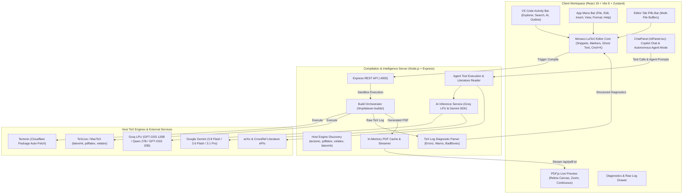

# 💬 Chat: hi

> **Session ID**: `0167fbcb-ff47-45d2-af26-b2278d9046d3`  
> **Model**: `gemini / gemini-3.1-flash` (`agent` mode)  
> **Started**: `2026-11-02T12:13:34.317Z`  
> **Last Updated**: `2026-11-02T12:18:45.388Z`  

---

## 👤 User

hi

## 👤 User

Please continue from where you left off.

## 🤖 Morph Agent (gemini-3.1-flash)


<details>
<summary>🛠️ Tool: <code>get_git_status</code> (success)</summary>

**Parameters**:
```json
{
  "cwd": null
}
```

**Output**:
```
Git Status (Branch: main):


Recent Commits:
fbd1f49|feat: add AccountPage, ProjectsPage, and PublicLayout components|2026-10-15
8eb7bec|feat: add AI agent state management, UI panels, and tools for automated LaTeX project editing|2026-10-15
7e4e19c|feat: implement core App routing, useProjectStore, and ProjectsPage dashboard interface|2026-10-15
fc73fbf|feat: implement client-side stores, state management, and UI components for user authentication and project workflows|2026-10-15
0075ab4|feat: initialize client application with authentication and Firebase setup|2026-10-15
```

</details>

## 🤖 Morph Agent (gemini-3.1-flash)


<details>
<summary>🛠️ Tool: <code>search_pathnames_only</code> (success)</summary>

**Parameters**:
```json
{
  "query": "implementation_plan.md",
  "includePattern": null,
  "pageNumber": 1
}
```

</details>

## 🤖 Morph Agent (gemini-3.1-flash)


<details>
<summary>🛠️ Tool: <code>search_pathnames_only</code> (success)</summary>

**Parameters**:
```json
{
  "query": "ROADMAP.md",
  "includePattern": null,
  "pageNumber": 1
}
```

**Output**:
```
/Users/vardhan/Documents/Github/ElseWhere/ROADMAP.md
```

</details>

## 🤖 Morph Agent (gemini-3.1-flash)


<details>
<summary>🛠️ Tool: <code>read_file</code> (success)</summary>

**Parameters**:
```json
{
  "uri": {
    "$mid": 1,
    "fsPath": "/Users/vardhan/Documents/Github/ElseWhere/ROADMAP.md",
    "external": "file:///Users/vardhan/Documents/Github/ElseWhere/ROADMAP.md",
    "path": "/Users/vardhan/Documents/Github/ElseWhere/ROADMAP.md",
    "scheme": "file"
  },
  "startLine": 1,
  "endLine": 100,
  "pageNumber": 1
}
```

**Output**:
```
/Users/vardhan/Documents/Github/ElseWhere/ROADMAP.md
```
# 🗺️ ElseWhere Engineering Roadmap

> Tracking engineering milestones, completed architectural modules, and industrial-grade differentiators for **ElseWhere** — the high-performance, local-first collaborative LaTeX & research authoring suite.

---

## 📊 Milestone Tracker & Progress Overview

| Phase | Milestone | Focus Area | Status | Delivery Target |
| :--- | :--- | :--- | :---: | :---: |
| **Phase 0** | **Foundation & Scaffolding** | Vite 8 + React 19 + Monaco + PDF.js + Virtual VFS | `[COMPLETED]` | Delivered |
| **Phase 1** | **Compilation Engine & Diagnostics** | Node.js Sandboxes + Tectonic/Multi-Engine + Diagnostic Parser | `[COMPLETED]` | Delivered |
| **Phase 2** | **Design Token System** | Tailwind CSS v4 + Semantic `@theme` + Dark Theme | `[COMPLETED]` | Delivered |
| **Phase 3** | **Dual AI Copilot & VS Code Activity Bar** | Groq LPU + Gemini + VS Code Activity Bar + Multi-View Sidebar | `[COMPLETED]` | Delivered |
| **Phase 4** | **Agentic AI & Research Intelligence** | Autonomous Agent + Copilot Chat + Universal Academic Search (250M+ Papers) + Base Paper Reading + Humanizer | `[COMPLETED]` | Delivered |
| **Phase 5** | **Professional IDE Workspace & Navigation** | Application Menu Bar + Editor Tab Pills + Settings Hub + PDF Preview Controls + VFS Folders | `[COMPLETED]` | Delivered |
| **Phase 6** | **Overleaf Industrial Differentiators** | AI Doctor `[DONE]`, SyncTeX `[DONE]`, Smart DOI/BibTeX `[DONE]`, TikZ Studio, PDF Diff, Pandoc/Word Export | `[IN PROGRESS]` | Q3 2026 |
| **Hardening Track** | **Security, Bug Fixes & Reliability** | RCE Sandboxing (`-no-shell-escape`), Windows PATH Delimiter, VFS Persistence, Math `$` Replace | `[COMPLETED]` | Delivered |
| **Phase 7** | **Sandboxing, Decoupled Queue & WASM** | Docker/Firecracker, BullMQ + Redis, Client-side WASM TeX (Offline) | `[PLANNED]` | Q3 2026 |
| **Phase 8** | **Multiplayer CRDTs & Git Sync** | Yjs Real-Time Engine, Track Changes, GitHub Two-Way Sync | `[PLANNED]` | Q4 2026 |
| **Phase 9** | **Enterprise Identity & Production Scale** | PostgreSQL/Drizzle, ORCID/SAML SSO, RBAC, Kubernetes Helm | `[PLANNED]` | Q4 2026 |
| **Phase 10** | **Public Web Portal & Commercial Hub** | Landing Page (`/`), Docs (`/docs`), Features (`/features`), Pricing + AI Keys (`/pricing`), Public Templates | `[COMPLETED]` | Delivered |
| **Phase 11** | **Multi-Project Hub & Continuous DB Sync** | Project Dashboard (`/projects`), Folder Isolation, Background Cloud Auto-Save, PostgreSQL/Drizzle Sync | `[PLANNED]` | Q3 2026 |
| **Phase 12** | **Teams, Labs & Collaborative Workspaces** | Organization Workspaces, Team Seats, Member RBAC, Shared Project Libraries | `[PLANNED]` | Q4 2026 |
| **Phase 13** | **Autonomous "One-Shot" Paper Generation Agent** | End-to-End Manuscript Synthesis (Hypothesis ➔ Full Draft + Math + Citations + Verified Build in 1-Click) | `[PLANNED]` | Q4 2026 |
| **Phase 14** | **Native Desktop Application Distribution** | Tauri + Rust Desktop Bundle (<15MB), Direct Local Filesystem I/O, True Offline Native TeX Execution | `[PLANNED]` | Q4 2026 |

---

## 🏗️ System Architecture Overview



### 🌐 Routing & Surface Separation: Public Web vs. Authenticated Studio

To maintain high SEO scores, instant landing page loads (<100ms FCP), and clear boundary isolation, the application architecture strictly partitions the **Public Web Portal** from the **Authenticated Research Studio Workspace**:

```mermaid
flowchart TD
    subgraph PublicDomain ["Public Web Surface (Lightweight, SEO-Optimized, Code-Split)"]
        Landing["Landing Page (/)<br/>Hero, Live Showcase, Value Props, Template Launcher"]
        Features["Feature Tour (/features)<br/>Interactive Speed & AI Benchmark Demos"]
        Docs["Documentation (/docs)<br/>Guides, LaTeX Cheatsheet, Compiler & API Manual"]
        Pricing["Pricing & Plans (/pricing)<br/>Free, Pro Researcher, Team Tiers + Bundled AI Keys"]
        PublicTemplates["Template Gallery (/templates)<br/>Categorized Academic, Beamer & Resume Starters"]
    end

    subgraph AuthBoundary ["Authentication & Route Guard (Clerk / Supabase / OAuth)"]
        AuthGate{"User Authenticated?"}
    end

    subgraph StudioDomain ["Authenticated Research Studio (Rich Client SPA + Heavy Tooling)"]
        ProjectDashboard["Project Hub (/projects)<br/>Project Creation, Folder Partitioning, Metadata"]
        
```
```

</details>

## 🤖 Morph Agent (gemini-3.1-flash)


<details>
<summary>🛠️ Tool: <code>search_in_file</code> (success)</summary>

**Parameters**:
```json
{
  "uri": {
    "$mid": 1,
    "fsPath": "/Users/vardhan/Documents/Github/ElseWhere/ROADMAP.md",
    "external": "file:///Users/vardhan/Documents/Github/ElseWhere/ROADMAP.md",
    "path": "/Users/vardhan/Documents/Github/ElseWhere/ROADMAP.md",
    "scheme": "file"
  },
  "query": "Phase 6",
  "isRegex": false
}
```

**Output**:
```
Line 17:
```
| **Phase 6** | **Overleaf Industrial Differentiators** | AI Doctor `[DONE]`, SyncTeX `[DONE]`, Smart DOI/BibTeX `[DONE]`, TikZ Studio, PDF Diff, Pandoc/Word Export | `[IN PROGRESS]` | Q3 2026 |
```

Line 386:
```
## 🚀 Phase 6: Overleaf Industrial Differentiators `[IN PROGRESS]`
```
```

</details>

## 🤖 Morph Agent (gemini-3.1-flash)


## 👤 User

hi

## 🤖 Morph Agent (gemini-3.1-flash)

<details>
<summary>💭 Thought Process (2s)</summary>

> **Interpreting User Input**
> 
> I'm working on understanding the user's intent with the input "hiPlease continue from where you left off." and the subsequent "hi." I'm currently parsing this as an implied request to resume a previous conversation or task. I'm focusing on the context to determine the nature of the "previous session".
> 
> 
> **Clarifying Project State**
> 
> I've determined that the current project context is "Phase 6" of `ElseWhere`, focusing on Overleaf-industrial differentiators such as TikZ Studio and PDF Diff. Recent updates include components for AccountPage, ProjectsPage, and public layout, as well as AI agent management. I'm ready to acknowledge the user and ask about their next desired action.

</details>

Hi there! Welcome back. 

Based on the project's current state and your `ROADMAP.md`, it looks like we recently completed the Public Web Portal components (like the `AccountPage`, `ProjectsPage`, and `PublicLayout`) along with the AI Agent state management.

We are currently in the middle of **Phase 6: Overleaf Industrial Differentiators**, with some exciting features lined up next:
*   **Vision TikZ Studio** (I see there's a `VisionTikzStudioModal.tsx` started)
*   **PDF Diff**
*   **Pandoc/Word Export**

We also have the **Project Dashboard & Multi-Project Hub (Phase 11)** on the horizon. 

What would you like to tackle today? Should we continue building out the Vision TikZ Studio, work on the backend for the Project Hub, or do you have something else in mind?

## 👤 User

hi

## 🤖 Morph Agent (gemini-3.1-flash)

Hello! How can I help you today? Are we continuing with the Phase 6 features, or is there a specific bug or task you'd like to focus on in the project?

## 👤 User

hi

## 🤖 Morph Agent (gemini-3.1-flash)

Hey! I'm here and ready whenever you are. 

Let me know what you'd like to work on, run, or debug in **ElseWhere**!

## 👤 User

hi

## 🤖 Morph Agent (gemini-3.1-flash)

Hello! How can I assist you today? Let me know what you'd like to work on!

