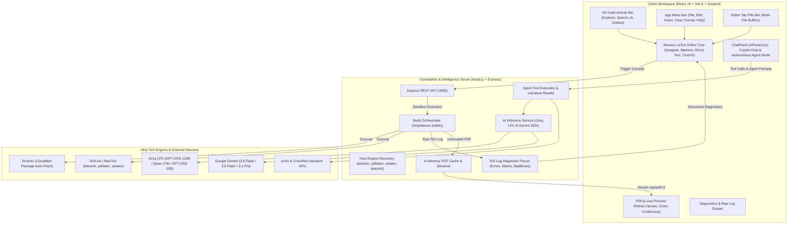
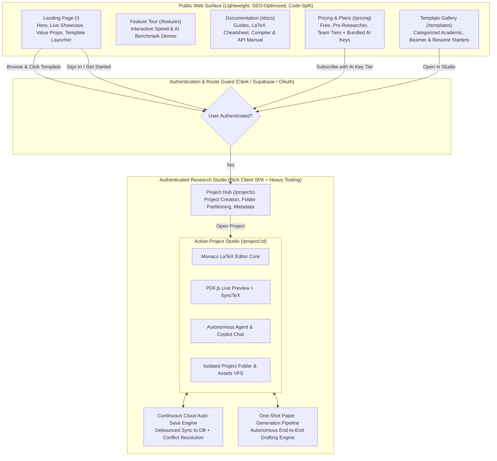
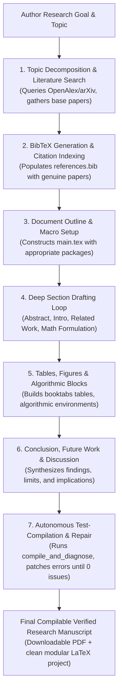

# 🗺️ ElseWhere Engineering Roadmap

> Tracking engineering milestones, completed architectural modules, and industrial-grade differentiators for **ElseWhere** — the high-performance, local-first collaborative LaTeX & research authoring suite.

---

## 📊 Milestone Tracker & Progress Overview

| Phase | Milestone | Focus Area | Status | Delivery Target |
| :--- | :--- | :--- | :---: | :---: |
| **Phase 0** | **Foundation & Scaffolding** | Vite 8 + React 19 + Monaco + PDF.js + Virtual VFS | `[COMPLETED]` | Delivered |
| **Phase 1** | **Compilation Engine & Diagnostics** | Node.js Sandboxes + Tectonic/Multi-Engine + Diagnostic Parser | `[COMPLETED]` | Delivered |
| **Phase 2** | **Design Token System** | Tailwind CSS v4 + Semantic `@theme` + Dark Theme | `[COMPLETED]` | Delivered |
| **Phase 3** | **Dual AI Copilot & VS Code Activity Bar** | Groq LPU + Gemini + VS Code Activity Bar + Multi-View Sidebar | `[COMPLETED]` | Delivered |
| **Phase 4** | **Agentic AI & Research Intelligence** | Autonomous Agent + Copilot Chat + Universal Academic Search (250M+ Papers) + Base Paper Reading + Humanizer | `[COMPLETED]` | Delivered |
| **Phase 5** | **Professional IDE Workspace & Navigation** | Application Menu Bar + Editor Tab Pills + Settings Hub + PDF Preview Controls + VFS Folders | `[COMPLETED]` | Delivered |
| **Phase 6** | **Overleaf Industrial Differentiators** | AI Doctor `[DONE]`, SyncTeX `[DONE]`, Smart DOI/BibTeX `[DONE]`, TikZ Studio, PDF Diff, Pandoc/Word Export | `[IN PROGRESS]` | Q3 2026 |
| **Hardening Track** | **Security, Bug Fixes & Reliability** | RCE Sandboxing (`-no-shell-escape`), Windows PATH Delimiter, VFS Persistence, Math `$` Replace | `[COMPLETED]` | Delivered |
| **Phase 7** | **Sandboxing, Decoupled Queue & WASM** | Docker/Firecracker, BullMQ + Redis, Client-side WASM TeX (Offline) | `[PLANNED]` | Q3 2026 |
| **Phase 8** | **Multiplayer CRDTs & Git Sync** | Yjs Real-Time Engine, Track Changes, GitHub Two-Way Sync | `[PLANNED]` | Q4 2026 |
| **Phase 9** | **Enterprise Identity & Production Scale** | PostgreSQL/Drizzle, ORCID/SAML SSO, RBAC, Kubernetes Helm | `[PLANNED]` | Q4 2026 |
| **Phase 10** | **Public Web Portal & Commercial Hub** | Landing Page (`/`), Docs (`/docs`), Features (`/features`), Pricing + AI Keys (`/pricing`), Public Templates | `[COMPLETED]` | Delivered |
| **Phase 11** | **Multi-Project Hub & Continuous DB Sync** | Project Dashboard (`/projects`), Folder Isolation, Background Cloud Auto-Save, PostgreSQL/Drizzle Sync | `[PLANNED]` | Q3 2026 |
| **Phase 12** | **Teams, Labs & Collaborative Workspaces** | Organization Workspaces, Team Seats, Member RBAC, Shared Project Libraries | `[PLANNED]` | Q4 2026 |
| **Phase 13** | **Autonomous "One-Shot" Paper Generation Agent** | End-to-End Manuscript Synthesis (Hypothesis ➔ Full Draft + Math + Citations + Verified Build in 1-Click) | `[PLANNED]` | Q4 2026 |
| **Phase 14** | **Native Desktop Application Distribution** | Tauri + Rust Desktop Bundle (<15MB), Direct Local Filesystem I/O, True Offline Native TeX Execution | `[PLANNED]` | Q4 2026 |

---

## 🏗️ System Architecture Overview



### 🌐 Routing & Surface Separation: Public Web vs. Authenticated Studio

To maintain high SEO scores, instant landing page loads (<100ms FCP), and clear boundary isolation, the application architecture strictly partitions the **Public Web Portal** from the **Authenticated Research Studio Workspace**:



#### Routing & Architectural Responsibility Matrix

| Route | Domain Area | Purpose & Contents | Heavy Bundle Loading | Auth Required |
| :--- | :--- | :--- | :---: | :---: |
| `/` | **Landing Page** | High-conversion hero, interactive preview demo, social proof, template launcher | ❌ None (Pure HTML/CSS/Tailwind) | No |
| `/features` | **Features Showcase** | Local-first compilation speed tests, AI Copilot vs. Overleaf comparisons, SyncTeX demos | ❌ None (Lazy static components) | No |
| `/docs` | **Documentation Hub** | Comprehensive documentation, LaTeX tutorials, keyboard shortcuts, API reference | ❌ None (Static markdown/MDX) | No |
| `/pricing` | **Pricing & Plans** | Subscription tiers (Free, Pro, Team, Lab), included managed AI key credits & BYOK | ❌ None (Stripe/LemonSqueezy elements) | No |
| `/templates` | **Template Gallery** | Browse academic papers, resumes, presentations, with 1-click "Open in Studio" | ❌ None (Card grid with preview thumbnails) | No |
| `/projects` | **Project Hub** | User's projects list, creation modal, project folder isolation, team switcher | ❌ Minimal | ✅ Yes |
| `/project/:id` | **Research Studio** | Full IDE: Monaco editor, PDF.js preview, SyncTeX, Autonomous Agent, VFS folder | 📦 Loaded on-demand (`React.lazy`) | ✅ Yes |

---

## 🏁 Phase 0: Foundation & Core Scaffolding `[COMPLETED]`

- [x] **Monorepo Architecture**:
  - Concurrent development workflow orchestrating Vite client (`:3000`) and Express server (`:4000`).
  - Production-ready proxying in `vite.config.ts` routing `/api` traffic seamlessly to the backend.
- [x] **Modern Client Scaffolding**:
  - React 19 (`react: ^19.2.8`), Vite 8 (`vite: ^8.3.0`), TypeScript 6 (`typescript: ~6.0.2`), and Oxlint (`oxlint: ^1.81.0`).
  - Zustand 5 state management store with persistent local storage hydration (`useProjectStore.ts`, `useLayoutStore.ts`, `useAiStore.ts`).
- [x] **Monaco LaTeX Editor Core** (`MonacoLatexEditor.tsx`):
  - Custom LaTeX syntax tokenization with high-contrast theme matching.
  - Native snippet completions: `\begin{equation}`, `\begin{figure}`, `\begin{table}`, `\begin{itemize}`, `\begin{enumerate}`, `\cite`, `\ref`, `\section`, formatting (`\textbf`, `\textit`).
  - Essential editor keybindings: `⌘ + Enter` / `Ctrl + Enter` (Recompile), `⌘ + S` (Save & Compile), `⌘ + K` (AI Inline Prompt), `⌘ + B` (Toggle Sidebar), `⌘ + J` (Toggle Diagnostics).
  - Auto-compilation debounce timer option (1.5s idle recompile).
- [x] **Mozilla PDF.js Hardware-Accelerated Preview** (`PdfViewer.tsx`):
  - Continuous multi-page canvas rendering with high-DPI / Retina display device pixel ratio support.
  - Viewport zoom controls (Zoom In, Zoom Out, Fit to Width) and continuous page indicator.
  - Cache-busting PDF reload streaming and 1-click PDF download action.
- [x] **Overleaf-Style Resizable Layout** (`WorkspaceLayout.tsx`):
  - `react-resizable-panels` implementation featuring multi-view Sidebar, Monaco Editor, and PDF Live Preview with responsive drag handles.
- [x] **Virtual Project File System (VFS)** (`FileTree.tsx`):
  - Multi-file project support (`.tex`, `.bib`, `.sty`, `.cls`, `.json`).
  - Binary image asset upload (PNG, JPG, PDF) with inline image preview.
  - File create, rename, and delete safeguards (`main.tex` protection).
  - 1-click project export to `.zip` via `jszip` and `file-saver`.
- [x] **Starter Template Gallery** (`templates/index.ts`, `TemplateModal.tsx`):
  - **Academic Research Paper**: Standard journal/conference layout with abstract, equations, tables, and BibTeX.
  - **Professional Resume / CV**: ATS-friendly technical resume layout.
  - **Beamer Presentation**: Conference slide deck styling with Metropolis/Madrid structure.
  - **Minimal Starter**: Clean, lightweight scientific note template.

---

## ⚙️ Phase 1: Local & Server Compilation Pipeline `[COMPLETED]`

- [x] **Isolated Workspace Execution Sandbox** (`compiler.ts`):
  - Node.js compilation worker generating ephemeral build directories (`/tmp/latexer-builds/<uuid>`).
  - Path sanitization to prevent directory traversal attacks on uploaded filenames.
  - In-memory PDF streaming buffer cache (`pdfCache`) with automated 1-hour TTL garbage collection.
- [x] **Native Engine Auto-Discovery & Multi-Engine Dispatcher** (`compiler.ts`):
  - Host executable probing across system `$PATH` and macOS distribution paths (`/Library/TeX/texbin`, `/opt/homebrew/bin`, `/usr/local/texlive`).
  - Native runtime dispatching: **Tectonic**, **latexmk**, **pdflatex**, and **xelatex**.
  - Tectonic Cloudflare bundle caching for instant on-demand LaTeX package resolution.
  - Host engine setup guide modal (`HostSetupModal.tsx`) with Homebrew / MacTeX installation commands.
- [x] **Zero-Dependency Fallback PDF Generator** (`fallbackPdf.ts`):
  - Generates lightweight PDF document if no host compiler is installed, guiding the user to install Tectonic.
- [x] **Structured TeX Log Diagnostic Parser** (`logParser.ts`):
  - Parses raw terminal logs into structured errors, warnings, and bad box (`\hbox` / `\vbox`) records.
  - Extracts exact file context, line numbers (`l.<num>`), and code snippets.
- [x] **Monaco Diagnostic Marker Synchronization**:
  - Maps parser errors directly into Monaco squiggly underlines (`monaco.editor.setModelMarkers`).
  - Synchronized bottom diagnostic drawer (`LogsDrawer.tsx`) with category filtering (All, Errors, Warnings) and raw console view.
  - 1-Click **"Jump to Line"** action navigating Monaco directly to the offending line.

---

## 🎨 Phase 2: Design Token System & Tailwind CSS v4 `[COMPLETED]`

- [x] **Tailwind CSS v4 Integration**:
  - Configured `@tailwindcss/vite` v4 plugin with zero-runtime overhead.
  - Unified `@theme` design tokens in `index.css`:
    - Semantic brand accents: `--color-brand` (`#00b875`), `--color-brand-glow`, `--color-accent-blue`.
    - Surface elevations: `--color-app` (`#0b0f17`), `--color-sidebar`, `--color-editor`, `--color-preview`, `--color-card`.
    - Modern typography tokens: Google Fonts Inter (UI) & JetBrains Mono / Fira Code (Editor & Snippets).
- [x] **Modular Component Architecture**:
  - Replaced monolithic styling with atomic utility classes and scoped CSS modules.
  - Enterprise `cn()` utility in `client/src/lib/utils.ts` combining `clsx` and `tailwind-merge`.
  - Polished micro-interactions: smooth transitions, custom dark scrollbars, glowing status pills, and backdrop blur.

---

## 🤖 Phase 3: Dual AI Copilot, VS Code Activity Bar & Multi-View Sidebar `[COMPLETED]`

- [x] **Dual AI Engine Architecture (Groq LPU & Google Gemini)** (`aiService.ts`, `aiApi.ts`, `useAiStore.ts`):
  - **Groq LPU Ultra-Fast Acceleration**: Sub-300ms completion speeds (~250+ tokens/sec) for publication-grade grammar, academic writing, and LaTeX equations via **GPT-OSS 120B** (`openai/gpt-oss-120b`), **Qwen 3.8 27B** (`qwen/qwen3.8-27b`), and **GPT-OSS 20B** (`openai/gpt-oss-20b`).
  - **Google Gemini Engine**: Native support for **Gemini 3.8 Flash**, **Gemini 3.6 Flash**, and **Gemini 3.1 Pro**.
  - Clean API key management: untracked `.env` backend keys with client override capability in `localStorage`.
- [x] **VS Code-Style Activity Bar Rail** (`ActivityBar.tsx`):
  - 46px leftmost vertical navigation rail.
  - Quick-switch view icons:
    - 📁 **File Explorer** (`⌘⇧E` / `Ctrl+Shift+E`) with live project file-count badge.
    - 🔍 **Search in Project** (`⌘⇧F` / `Ctrl+Shift+F`) with global search and replace across virtual files.
    - ✨ **AI Copilot** with active model indicator pill.
    - 📑 **Document Outline** (`ListTree`) with structural LaTeX element parser.
    - ⚙️ **Settings Gear** at the bottom rail opening the engine & AI settings dialog.
- [x] **Multi-View Sidebar Panels**:
  - `SearchPanel.tsx`: Full-text search and replace across all project files with case-sensitivity, file match grouping, and click-to-jump to editor line.
  - `OutlinePanel.tsx`: Parsed LaTeX outline (`\section`, `\subsection`, `table`, `figure`, `equation`) with line jump navigation.
  - `AiPanel.tsx`: Dedicated sidebar AI view with quick action chips (*Fix Errors*, *Academic Polish*, *Add Comments*) and 1-click Monaco insertion.
- [x] **Inline AI Command Palette (`⌘ + K`)** (`InlineCommandPalette.tsx`):
  - Floating Monaco overlay triggered anywhere in the document.
  - Selection-aware prompt execution: replaces selected code with refined LaTeX or generates new sections at the cursor in <250ms via Groq.
- [x] **Streamlined Top Title Bar** (`TopNav.tsx`):
  - Cleaned up duplicate and redundant buttons for a sleek, uncluttered header experience.

---

## 🧠 Phase 4: Agentic Intelligence, Research Synthesis & Writing Humanization `[COMPLETED]`

### 4.1 ChatPanel Architecture & Activity Bar Rail Navigation (`ActivityBar.tsx`, `AiPanel.tsx`) `[COMPLETED]`
- [x] **Activity Bar Rail First-Class Navigation**:
  - Reorganized AI and research tools into dedicated top-level icons on the leftmost vertical Activity Bar rail:
    - 🤖 **Autonomous Agent** (`agent`): Goal composer, multi-step tool calls, execution diffs.
    - 💬 **Copilot Chat** (`chat`): Multi-turn conversational AI with active model indicator.
    - 📖 **Reference Papers** (`papers`): Universal academic web search, download redirection, literature synthesis.
    - 🛡️ **AI Detector & Humanizer** (`humanizer`): Sentence perplexity scanner & academic rhythm rewriter.
  - Removed internal pill switcher buttons from `AiPanel`, giving each panel full height and clean standard headers.
- [x] **Copilot Chat Interface & Formatting**:
  - [x] Multi-turn conversational history maintaining author-copilot dialogue.
  - [x] Interactive LaTeX code cards with syntax badges, copy button, and 1-click Monaco cursor insertion (`insertAtCursor`).
  - [x] 4 one-click starter quick action chips (*Polish Academic Tone*, *Add Math Equation*, *Create Table*, *Fix LaTeX Errors*).
  - [x] **Rich Markdown Message Renderer**: Render bold, italics, bullet lists, numbered lists, headings, and inline math/code instead of raw markdown characters.
  - [x] **Auto-Resizing Composer Textarea**: Dynamic height expansion up to 160px with `Enter` (send) and `Shift + Enter` (newline) handling.
  - [x] **Dynamic Provider Placeholders & Sender Metadata**: Contextual placeholders matching active engine and immutable provider branding on message bubbles.
  - [x] **Document Context & Selection Toggle**: Toggle switch for `[x] Include Document Context` and active selection line-count badge.
  - [x] **Thread Persistence**: Store recent conversation history in `localStorage` so chats survive browser refreshes.
- [x] **Autonomous Agent Workspace UI**:
  - [x] Goal composer with pre-configured task chips (*Fix Errors*, *Booktabs Tables*, *BibTeX Citations*, *Math Appendix*).
  - [x] Clean user message box and direct agent response card (no redundant headers or emoji clutter).
  - [x] Interactive tool call cards displaying tool icon, execution state badges (`running`, `success`, `error`), and error diagnostics.
  - [x] Live syntax diff cards showing surgical file modifications (`- target` / `+ replacement`).
  - [x] Step progress counter (`Step X/10`) with live execution footer.
  - [x] **Execution Cancellation & Status Badges**: `AbortController` integration with responsive `Stopped` / `Aborted` state indicators.
  - [x] **Expandable Tool Data Inspector**: Collapsible drawer revealing returned search results, line numbers, and raw compiler diagnostic logs.

### 4.2 Autonomous Agent Mode & Prompt Architecture (`prompts.ts`) `[COMPLETED]`
- [x] **Modular Prompt Architecture (`prompts.ts`)**:
  - Domain-specific prompt generators inspired by modern AI IDE architectures (`buildAgentSystemPrompt`, `buildChatSystemPrompt`, `buildInlineEditPrompt`).
  - Dynamic `<workspace_context>` injection (active file, open files list, compiler engine).
  - **Fast-Path Intent Detection**: Zero tool calls for greetings (*"hi"*, *"who are you"*) and conceptual/academic queries; direct friendly responses without over-inspecting the workspace.
  - **Anti-Narration Rule**: Prohibits routine narration ("I will now call read_file") to keep agent execution clean and direct.
  - **Reasoning Isolation**: Internal model reasoning (`choice.message.reasoning`) is decoupled from user-facing `content`, preventing monologue leaks into chat bubbles.
- [x] **Autonomous Goal Execution**:
  - Autonomous Agent mode capable of breaking down high-level manuscript and coding goals across the workspace.
  - Iterative `Plan ➔ Act ➔ Observe ➔ Reflect ➔ Verify` execution cycle (up to 10 sequential steps).
- [x] **Interactive Execution Plan Preview** (`ExecutionPlanModal.tsx`):
  - Displays proposed step-by-step roadmap of file edits before modifying workspace files.
  - Allows user approval, step rejection, or single-step execution checkpoints via "Plan First".
- [x] **Automated Test-Compile & Self-Correction**:
  - Automatically triggers compilation via `compile_and_diagnose` after writing code.
  - Inspects compiler diagnostic logs; if syntax errors or missing packages occur, autonomously patches files until the project compiles with 0 errors.

### 4.3 Agent Tool Calling Suite for Workspace File Manipulation `[COMPLETED]`
- [x] Standardized structured Tool Calling API (Groq function calling & Gemini tool declarations):
  - `list_files`: Scan virtual project tree and asset metadata.
  - `read_file(path, start_line?, end_line?)`: Read file contents or line slices.
  - `write_file(path, content)`: Create new files or overwrite existing files.
  - `edit_file(path, target_snippet, replacement_snippet)`: Surgical diff/replacement edits.
  - `delete_file(path)`: Safe file deletion (`main.tex` protected).
  - `search_files(query, case_sensitive?)`: Project-wide grep search across all text files.
  - `compile_and_diagnose(engine?)`: Trigger build and return structured diagnostics to the agent.
- [x] Interactive tool execution badges in the AI sidebar with status chips, result messages, and live diff previews.

### 4.4 Deep Reasoning & Extended Thinking Capacity `[COMPLETED]`
- [x] Support for flagship reasoning models:
  - **DeepSeek-R1 Distill 70B**, **DeepSeek-R1 Distill 32B**, **Gemini 2.0 Flash Thinking**, and Groq reasoning endpoints.
- [x] **Collapsible Thinking Trace UI Component** (`ThinkingTrace.tsx`):
  - Render thought processes inside an expandable `<ThinkingTrace>` component with real-time streaming pulses.
  - Separates internal reasoning (mathematical derivations, proof strategies, structural planning) from the final generated LaTeX code.
- [x] Configurable reasoning effort (Low / Medium / High / Deep) in the AI settings modal and settings store.

### 4.5 Literature Understanding: Universal Academic Search & Base Paper Ingestion `[COMPLETED]`
- [x] **Universal Academic Paper Search Engine Across the Web** (`paperSearch.ts`, `ReferencePapersView.tsx`):
  - Concurrently queries **OpenAlex** (indexing 250M+ scholarly works) and **arXiv** with real-time deduplication.
  - Global academic coverage across **IEEE, Nature, ACM, Springer, Elsevier, ScienceDirect, PubMed, and arXiv**.
  - **Direct Download & Publisher Page Redirection**: Direct external links to official publisher download pages (IEEE Xplore, ScienceDirect, Nature, etc.).
  - **Google Scholar Redirection**: 1-click links opening Google Scholar for institutional library access, proxy downloads, and citation trees.
  - **Scope Filters**: Quick filters for `🌐 All Web`, `⚡ arXiv Direct`, and `🏛️ Journals & IEEE`.
  - **Rich Metadata Badges**: Live citation count indicators (`★ X cites`), publisher badges, and publication years.
  - **1-Click Workspace Ingestion**: Imports paper title, authors, year, and abstract directly into the project library with 0 manual downloads required.
  - **1-Click BibTeX Citation**: Formatted `@article{...}` copying and instant appending to `references.bib`.
- [x] **Multi-Modal Research Paper Ingestion** (`ReferencePapersView.tsx`):
  - Dedicated "My Papers" view: upload base research PDFs (e.g., arXiv downloads, conference papers).
  - Client-side hardware-accelerated PDF extraction parsing text, equations, tables, and references from uploaded base papers via `pdfjs-dist`.
- [x] **Literature Review & Grounded Manuscript Writing**:
  - Ground AI responses on uploaded papers to draft Literature Reviews and Related Work sections with zero hallucinations.
  - Automatic extraction of baseline data to build comparative benchmark tables (`booktabs`).
  - Extract and format cited papers directly into clean BibTeX entries appended to `references.bib`.

### 4.6 Ghost Text AI Inline Code Completions `[COMPLETED]`
- [x] Monaco `InlineCompletionsProvider` delivering real-time gray phantom text as the author types.
- [x] Ultra-fast debounced generation (~150ms via Groq LPU fast inference / Google Gemini).
- [x] Predicts equation completions, math symbols, `\item` enumerations, and academic sentence continuations.
- [x] Standard editor shortcuts: `Tab` to accept ghost text, `Esc` to dismiss, `⌥\` / `Alt+\` to trigger. Copilot toggle badge in editor toolbar.

### 4.7 AI Writing Detection Analysis & Academic Humanizer Engine `[COMPLETED]`
- [x] **AI Writing Detection Scanner** (`HumanizerDetectorView.tsx`):
  - Real-time sentence-level perplexity and burstiness evaluator.
  - Visual heatmap overlay highlighting robotic, repetitive, or formulaic sentences.
  - Overall originality / human-writing score indicator.
- [x] **Academic Humanizer Engine** (`HumanizerDetectorView.tsx`):
  - 1-Click **"Humanize Selection"** and document action.
  - Strips synthetic AI clichés (*"delve into"*, *"testament to"*, *"pivotal role"*, *"moreover"*, *"furthermore"*, *"in conclusion"*).
  - Rewrites text with authentic academic rhythm, varied sentence lengths, natural signposting, and field-appropriate scientific vocabulary while strictly preserving technical accuracy and LaTeX math environments.

---

## 🖥️ Phase 5: Professional IDE Workspace, Application Menu & Settings Hub `[COMPLETED]`

### 5.1 Desktop Application Menu Bar (`File`, `Edit`, `Insert`, `View`, `Format`, `Help`) `[COMPLETED]`
- [x] Desktop-grade application menu bar with interactive dropdown menus, keyboard accelerators, and Monaco event dispatcher:
  - **File**: New File (`.tex`), Upload File, Templates Picker, Download PDF, Export Project ZIP, Settings (`⌘,`).
  - **Edit**: Undo (`⌘Z`), Redo (`⌘⇧Z`), AI Inline Assistant (`⌘K`), Toggle AI Sidebar, Clear AI Chat.
  - **Insert**: Section, Subsection, Figure environment (`graphicx`), Table environment (`tabular`), Equation environment (`equation`), Citation (`\cite`), Footnote (`\footnote`).
  - **View**: Split View, Code Focus (Editor Only), Reading Focus (PDF Only), Toggle Logs & Diagnostics (`⌘J`), Reset Layout Proportions.
  - **Format**: Bold (`\textbf`), Italic (`\textit`), Monospace Code (`\texttt`), Itemize (Bullet list), Enumerate (Numbered list).
  - **Help**: Interactive Keyboard Shortcuts, LaTeX Quick Reference & Cheatsheet modal, Local TeX Engine Setup dialog, About ElseWhere modal.
- [x] **Dynamic Title Bar & Full Document Name**:
  - Center-positioned, adaptive-width document name input (`min-w-[320px]` to `540px`) preventing truncation and showing the complete project title.
  - Streamlined `h-10 min-h-[40px]` navbar height saving vertical screen real-estate for the editor and preview.

### 5.2 Opened File Tab Pills Bar (Multi-File Editor Tabs) `[COMPLETED]`
- [x] Multi-file tab bar positioned above the Monaco LaTeX editor (`EditorTabs.tsx` / `MonacoLatexEditor.tsx`):
  - Displays file pill tabs for all open virtual files (`main.tex`, `references.bib`, `custom.sty`).
  - Active tab highlight with distinct border and background tokens.
  - Close tab (`×`) action button on each tab pill.
  - Context menu on tabs: Close, Close Others, Close All.
  - Shortcuts: `⌘W` to close active tab, `⌘1`–`⌘9` for instant tab switching.

### 5.3 PDF Viewer Toolbar & Smart File Downloads `[COMPLETED]`
- [x] **Top Preview Toolbar Reorganization** (`PdfViewer.tsx`):
  - Recompile button relocated directly to the PDF preview toolbar with compilation spinner and status color transitions.
  - Compact icon-based diagnostics badge (`AlertCircle` for errors, `AlertTriangle` for warnings, `CheckCircle2` for compiled, `Terminal` for ready) with count badges. Clicking toggles compilation logs drawer.
  - Zoom controls (Zoom In, Zoom Out, Fit to Width) and continuous page navigation controls.
- [x] **Project-Named PDF Downloads**:
  - Client-side blob fetching using `saveAs(blob, `${cleanName}.pdf`)` guaranteeing that the browser uses the project name (e.g., `academic_research_manuscript.pdf`) without server `main.pdf` header overrides.
  - Backend `/api/pdf/:buildId` endpoint supporting `?filename=` query parameter and dynamic `Content-Disposition: attachment`.

### 5.4 Hierarchical Folders & Directory Creation in VFS `[COMPLETED]`
- [x] Support nested directory hierarchies in the Virtual File System (e.g., `chapters/intro.tex`, `figures/diagram.png`, `styles/macros.sty`).
- [x] **Folder Operations** (`FileTree.tsx`, `useProjectStore.ts`):
  - "New Folder" icon and creation dialog in the File Explorer panel.
  - Collapsible tree view (`Folder`, `FolderOpen`, `ChevronDown`, `ChevronRight`) with persistent expansion states.
  - Nested file creation and folder-level deletion (`deleteFolder`).
- [x] **Compiler Sandbox Path Preservation** (`compiler.ts`):
  - Compiler worker preserves relative folder structures (`fs.mkdir(path.dirname(filePath), { recursive: true })`) so `\input{chapters/intro}` and `\includegraphics{figures/diagram}` compile seamlessly without path errors.

### 5.5 Comprehensive Multi-Category Settings Hub (`SettingsModal.tsx`) `[COMPLETED]`
- [x] Unified, tabbed Settings dialog with deep customization categories:
  - **Appearance**: Editor Theme (Dark / Light / Warm Parchment), Dark Mode PDF toggle, Font Size slider, Font Family (Inter, JetBrains Mono, Fira Code), Line Height slider, Custom PDF background color picker.
  - **Editor**: Word Wrap toggle, Line Numbers mode (`on` / `off`), Bracket Pair Colorization, Code Snippets toggle.
  - **Compiler**: Default engine selection (Auto, Tectonic, LaTeXmk, pdfLaTeX, XeLaTeX), Auto-compile toggle with debouncing.
  - **Spelling & Language**: Spell check toggle, Language selector (en-US, en-GB, fr, de, es).
  - **References**: BibTeX citation management, auto-formatting keys.
  - **Notifications**: Notify on compile error, notify on compilation success.
  - **AI Models & Intelligence**: Provider toggle (Groq LPU vs. Google Gemini), API key management, active model selector.
- [x] **Advanced Document Outline & Section Tree Navigator** (`OutlinePanel.tsx`):
  - Hierarchical LaTeX element parsing (`\section`, `\subsection`, `figure`, `table`, `equation`) with 1-click line jumping.

---

## 🚀 Phase 6: Overleaf Industrial Differentiators `[IN PROGRESS]`

### 6.1 AI Error Doctor (1-Click Auto-Patching) `[COMPLETED]`
- [x] Dedicated **"Fix with AI"** and **"Auto-Fix All"** integration in `LogsDrawer.tsx` and `PdfViewer.tsx` error banners.
- [x] Structured diagnostic payload generator (`aiDoctor.ts`: `formatDoctorFixAllPrompt`, `formatDoctorFixSinglePrompt`) feeding line numbers, compiler error messages, snippet contexts, and TeX log tails directly to the Autonomous Agent.
- [x] Autonomous repair cycle: Agent inspects offending files, applies surgical replacements, and immediately test-compiles via `compile_and_diagnose` to verify zero errors before reporting back.

### 6.2 SyncTeX Bi-Directional Forward & Inverse Navigation `[COMPLETED]`
- [x] **Compiler Synchronization Flag**: Enabled `--synctex` on Tectonic and `-synctex=1` across `latexmk`, `pdflatex`, and `xelatex`.
- [x] **SyncTeX Parser & In-Memory Indexer** (`synctex.ts`):
  - Automatically uncompresses `.synctex.gz` (and uncompressed `.synctex`), indexes coordinates into efficient `fileMap` and `pageMap`.
  - Excludes internal TeX distribution runtime definitions (`.cls`, `.sty`, `.def`, `.ldf`).
- [x] **Bidirectional Backend Endpoints** (`index.ts`):
  - Forward Sync: `/api/synctex/forward?buildId=&file=&line=` returning target `(page, xPt, yPt)`.
  - Reverse Sync: `/api/synctex/reverse?buildId=&page=&xPt=&yPt=` returning `(file, line)`.
- [x] **Sub-Pixel Word-Level Bounding Rect Highlight** (`PdfViewer.tsx`):
  - `computeWordRect` and `getWordBoundingRect` performing DOM Range and proportional bounding calculation inside the PDF.js text layer.
  - Smooth animated scroll-to-view and temporary glowing highlight pulse.
- [x] **Inverse Jump to Source** (`MonacoLatexEditor.tsx`, `useProjectStore.ts`):
  - `⌘ + Click` / Click on PDF preview triggers `reverseSyncToCode`, automatically switching active file tab and highlighting the source line with `synctex-highlight-editor-line`.

### 6.3 Smart Bibliography & DOI / arXiv Auto-Fetcher `[COMPLETED]`
- [x] **Multi-Source Scholarly Search Engine** (`paperSearch.ts`):
  - Direct concurrent querying across OpenAlex, arXiv, Crossref, and Semantic Scholar with reciprocal rank fusion (RRF).
- [x] **Instant BibTeX Generation & 1-Click Library Ingestion** (`ReferencePapersView.tsx`):
  - Automatically converts paper DOIs, titles, authors, and venues into standard `@article{...}` / `@inproceedings{...}` blocks.
  - 1-Click append directly to `references.bib` with duplicate key detection.
- [x] **Base Paper Full-Text Reading & Multi-Modal Literature Review**:
  - Upload research paper PDFs; extracts text, abstracts, and tables client-side via `pdfjs-dist`.
  - Synthesizes related work sections, benchmark tables, and comparative analyses directly into the manuscript.

### 6.4 Multimodal "Screenshot-to-LaTeX", Plot-to-TikZ & Isolated Studio `[COMPLETED]`
- [x] **Multimodal Formula & Whiteboard OCR (Vision-to-LaTeX)**:
  - Paste or drag screenshot of handwritten equations, textbook formulas, or whiteboard derivations directly into Monaco editor.
  - Powered by Gemini / Groq Multimodal: parses multi-line symbols, matrices, summations, and integral bounds into clean, idiomatic `\begin{align}` or `\begin{equation}` environments in <1s.
- [x] **Diagram & Plot-to-TikZ Vectorizer**:
  - Paste raster plots, architecture flowcharts, neural network diagrams, or circuit schematics.
  - AI vision engine converts the image into clean, editable vector `\begin{tikzpicture}` code using modern TikZ libraries (`shapes`, `arrows.meta`, `positioning`).
- [x] **VisionTikzStudioModal**:
  - Dedicated interactive modal with clipboard paste detection (Ctrl+V), image preview, formula OCR, diagram-to-TikZ vectorization, and 1-click cursor insertion into Monaco editor.

### 6.5 Visual Rendered PDF Diffing `[PLANNED]`
- [ ] Compare rendered PDF pages between compilation builds, saved checkpoints, or git commits.
- [ ] Visual overlay: highlights added paragraphs/equations in emerald green and deleted items in crimson red directly on the PDF pages.
- [ ] Toggle between split side-by-side mode and opacity slider overlay mode.

### 6.6 Multi-Format Publishing Engine (Pandoc / Quarto) `[PLANNED]`
- [ ] Export project to Microsoft Word (`.docx`) for non-LaTeX co-authors and journal reviewers.
- [ ] Export to clean GitHub Flavored Markdown (`.md`) and interactive HTML5 research article with KaTeX math rendering.
- [ ] Import from Markdown / Docx into native LaTeX workspace.

---

## 🔍 Codebase Audit Register: Discovered Bugs, Security Vulnerabilities & Engineering Fixes

> Tracking all concrete findings from in-depth codebase static analysis and runtime verification across the client and server compilation engine, categorized by severity, component, root cause, and remediation plan.

### 📊 Vulnerability & Defect Severity Matrix

| Issue ID | Category | Component | File Location | Severity | Status |
| :--- | :--- | :--- | :--- | :---: | :---: |
| **SEC-01** | Security (RCE) | Compilation Sandbox | [`server/src/compiler.ts:L168`](file:///c:/Users/SRMAP/Documents/Github/ElseWhere/server/src/compiler.ts#L168-L173) | `CRITICAL` | `[RESOLVED]` |
| **SEC-02** | Security (Traversal) | Virtual File Writer | [`server/src/compiler.ts:L140`](file:///c:/Users/SRMAP/Documents/Github/ElseWhere/server/src/compiler.ts#L140-L153) | `HIGH` | `[RESOLVED]` |
| **BUG-01** | Runtime Bug | TeX Engine Discovery | [`server/src/compiler.ts:L16`](file:///c:/Users/SRMAP/Documents/Github/ElseWhere/server/src/compiler.ts#L16-L34) | `HIGH` | `[RESOLVED]` |
| **BUG-02** | Data Loss Bug | Global Search & Replace | [`client/src/components/Sidebar/SearchPanel.tsx:L88`](file:///c:/Users/SRMAP/Documents/Github/ElseWhere/client/src/components/Sidebar/SearchPanel.tsx#L88-L95) | `HIGH` | `[RESOLVED]` |
| **BUG-03** | Data Loss Bug | Virtual File System | [`client/src/store/useProjectStore.ts:L79`](file:///c:/Users/SRMAP/Documents/Github/ElseWhere/client/src/store/useProjectStore.ts#L79-L105) | `HIGH` | `[RESOLVED]` |
| **BUG-04** | Runtime Crash | AI Copilot (Gemini) | [`server/src/aiService.ts:L394`](file:///c:/Users/SRMAP/Documents/Github/ElseWhere/server/src/aiService.ts#L394-L410) | `MEDIUM` | `[RESOLVED]` |
| **BUG-05** | Parsing Warning | Fallback PDF Engine | [`server/src/fallbackPdf.ts:L22`](file:///c:/Users/SRMAP/Documents/Github/ElseWhere/server/src/fallbackPdf.ts#L22-L42) | `MEDIUM` | `[RESOLVED]` |
| **PERF-01** | Performance & Quota | Monaco Keystroke Store | [`client/src/store/useProjectStore.ts:L79`](file:///c:/Users/SRMAP/Documents/Github/ElseWhere/client/src/store/useProjectStore.ts#L79-L105) | `HIGH` | `[RESOLVED]` |
| **PERF-02** | Network Dependency | Tectonic Engine | [`server/src/compiler.ts:L168`](file:///c:/Users/SRMAP/Documents/Github/ElseWhere/server/src/compiler.ts#L168) | `MEDIUM` | `[RESOLVED]` |
| **DEV-01** | Compiler Warning | React 19 Concurrent | [`PdfViewer.tsx`, `MonacoLatexEditor.tsx`](file:///c:/Users/SRMAP/Documents/Github/ElseWhere/client/src/components/Preview/PdfViewer.tsx#L287) | `LOW` | `[RESOLVED]` |
| **PERF-03** | Engine Warning | Production Dockerfile | [`Dockerfile:L8`](file:///c:/Users/SRMAP/Documents/Github/ElseWhere/Dockerfile#L8) | `LOW` | `[RESOLVED]` |
| **DEV-02** | Windows Native | Build Toolchain | [`client/package.json`](file:///c:/Users/SRMAP/Documents/Github/ElseWhere/client/package.json) | `MEDIUM` | `[RESOLVED]` |

---

### A. 🚨 Critical Security Vulnerabilities

#### 1. [SEC-01] LaTeX Shell Escape / Remote Code Execution (`\write18`)
- **Location**: [`server/src/compiler.ts:L145-L150`](file:///c:/Users/SRMAP/Documents/Github/ElseWhere/server/src/compiler.ts#L145-L150)
- **Vulnerability**: Standard TeX distributions (`pdflatex`, `xelatex`, `latexmk`) permit arbitrary operating system command execution via `\immediate\write18{...}` or `\input|...` unless shell escape is explicitly forbidden via CLI flags. Without isolation, any user could submit a document executing host processes.
- **Root Cause**:
  ```ts
  args = ['-interaction=nonstopmode', '-file-line-error', '-synctex=1', mainFile];
  ```
  Missing `-no-shell-escape` parameter allows arbitrary command execution.
- **Remediation Plan**:
  - Inject `-no-shell-escape` across all `pdflatex`, `xelatex`, and `latexmk` command invocations.
  - Implement pre-compilation regex scan to flag and block `\write18` and pipe-input attempts before spawning the process.

#### 2. [SEC-02] Path Traversal in Ephemeral Build Directory Materialization
- **Location**: [`server/src/compiler.ts:L127-L130`](file:///c:/Users/SRMAP/Documents/Github/ElseWhere/server/src/compiler.ts#L127-L130)
- **Vulnerability**: Sanitizing virtual file paths with `replace(/^(\.\.[\/\\])+/, '')` only removes leading relative dots. Windows drive letters (e.g. `C:\...`) or nested sequences could resolve outside `/tmp/latexer-builds/<uuid>`.
- **Root Cause**:
  ```ts
  const sanitizedPath = path.normalize(file.path).replace(/^(\.\.[\/\\])+/, '');
  const filePath = path.join(buildDir, sanitizedPath);
  ```
- **Remediation Plan**:
  - Enforce strict canonical path resolution:
    ```ts
    const targetPath = path.resolve(buildDir, sanitizedPath);
    if (!targetPath.startsWith(path.resolve(buildDir) + path.sep)) {
      throw new Error(`Access denied: path traversal attempt detected (${file.path})`);
    }
    ```

---

### B. 🐛 Definite Bugs & Runtime Errors

#### 3. [BUG-01] Cross-Platform PATH Delimiter Corruption on Windows
- **Location**: [`server/src/compiler.ts:L16-L25`](file:///c:/Users/SRMAP/Documents/Github/ElseWhere/server/src/compiler.ts#L16-L25)
- **Root Cause**: `ADDITIONAL_PATHS.join(':')` hardcodes Unix colon delimiters. On Windows, the delimiter is `;` and drive letters contain colons (`C:\...`). Prepending `:` corrupts the system environment string, causing `execFileAsync` to fail locating MiKTeX or TeXLive executables.
- **Remediation Plan**:
  - Dynamically use `path.delimiter` (`process.platform === 'win32' ? ';' : ':'`).
  - Append standard Windows distribution directories (`C:\Program Files\MiKTeX\miktex\bin\x64`, `C:\texlive\...\bin\windows`).

#### 4. [BUG-02] Mathematical Dollar-Sign (`$`) String Corruption in Global Search & Replace
- **Location**: [`client/src/components/Sidebar/SearchPanel.tsx:L88-L95`](file:///c:/Users/SRMAP/Documents/Github/ElseWhere/client/src/components/Sidebar/SearchPanel.tsx#L88-L95)
- **Root Cause**: `current.content.replace(reg, replacement)` evaluates special regex replacement tokens (`$1`, `$&`, `$'`). When a user replaces text with LaTeX equations (e.g., `$x$`, `$$...$$`, `$\lambda$`), JavaScript substitutes capture groups or removes the equation.
- **Remediation Plan**:
  - Use a functional replacer to guarantee literal text substitution: `current.content.replace(reg, () => replacement)`.

#### 5. [BUG-03] Incomplete VFS Persistence (Data Loss on Browser Refresh)
- **Location**: [`client/src/store/useProjectStore.ts:L218-L282`](file:///c:/Users/SRMAP/Documents/Github/ElseWhere/client/src/store/useProjectStore.ts#L218-L282)
- **Root Cause**: Only `updateFileContent` saved workspace state to `localStorage`. `createFile`, `deleteFile`, `renameFile`, `createFolder`, and `deleteFolder` lacked serialization calls, causing newly created or deleted files to revert on refresh.
- **Remediation Plan**:
  - Centralize state synchronization in a unified `persistProjectState(state)` helper called after all VFS mutations.

#### 6. [BUG-04] Google Gemini Multi-Turn Conversation Schema Crash
- **Location**: [`server/src/aiService.ts:L394-L396`](file:///c:/Users/SRMAP/Documents/Github/ElseWhere/server/src/aiService.ts#L394-L396)
- **Root Cause**: The `@google/generative-ai` SDK rejects messages with `role: 'assistant'` or flat `{ content: string }`, requiring `{ role: 'model', parts: [{ text }] }`. Messages formatted for Groq/OpenAI throw uncaught exceptions in Gemini chats.
- **Remediation Plan**:
  - Normalize conversation history format in `chatWithGemini` to translate roles (`assistant` ➔ `model`) and wrap content into `parts: [{ text }]`.

#### 7. [BUG-05] Corrupted XRef Byte Offsets & Startxref in Fallback PDF
- **Location**: [`server/src/fallbackPdf.ts:L62-L76`](file:///c:/Users/SRMAP/Documents/Github/ElseWhere/server/src/fallbackPdf.ts#L62-L76)
- **Root Cause**: The cross-reference table contains hardcoded byte offsets and estimated startxref offsets (`400 + streamLength`). PDF.js triggers `Warning: Indexing all PDF objects` and standalone PDF viewers report damaged files.
- **Remediation Plan**:
  - Dynamically calculate the exact byte offsets of `1 0 obj`, `2 0 obj`, `3 0 obj`, `4 0 obj`, and the `xref` keyword.

---

### C. ⚡ Performance & Reliability Improvements

#### 8. [PERF-01] Synchronous Keystroke Serialization & 5MB `QuotaExceededError`
- **Location**: [`client/src/store/useProjectStore.ts:L193-L215`](file:///c:/Users/SRMAP/Documents/Github/ElseWhere/client/src/store/useProjectStore.ts#L193-L215)
- **Bottleneck**: `updateFileContent` ran `JSON.stringify` on the entire file dictionary and called `localStorage.setItem` synchronously on every keystroke. This causes typing stutter on large files and triggers browser quota failures when base64 image assets are present.
- **Remediation Plan**:
  - Debounce `localStorage` serialization by 500ms.
  - Store binary assets (images, PDFs) in browser IndexedDB via `idb-keyval` rather than `localStorage`.

#### 9. [PERF-02] Hardcoded Remote Tectonic Bundle URL Dependency
- **Location**: [`server/src/compiler.ts:L144`](file:///c:/Users/SRMAP/Documents/Github/ElseWhere/server/src/compiler.ts#L144)
- **Bottleneck**: `--bundle https://data1b.fullyjustified.net/tlextras-2022.0r0.tar` forces Tectonic to attempt remote tarball downloads on every compilation, causing failures when offline or on unstable networks.
- **Remediation Plan**:
  - Remove the forced `--bundle` parameter, permitting Tectonic to use its official local bundle cache.

#### 10. [DEV-01] React 19 Concurrent Ref Mutation Warnings
- **Location**: [`PdfViewer.tsx:L287`](file:///c:/Users/SRMAP/Documents/Github/ElseWhere/client/src/components/Preview/PdfViewer.tsx#L287), [`MonacoLatexEditor.tsx:L136`](file:///c:/Users/SRMAP/Documents/Github/ElseWhere/client/src/components/Editor/MonacoLatexEditor.tsx#L136)
- **Issue**: Mutating `ref.current` directly in the component render body violates React 19 concurrent rendering purity rules and triggers Oxlint warnings.
- **Remediation Plan**:
  - Shift ref updates to `useEffect` or derive values directly from reactive state.

#### 11. [PERF-03] Production Docker Node Engine Alignment (Node 22)
- **Location**: [`Dockerfile:L8`](file:///c:/Users/SRMAP/Documents/Github/ElseWhere/Dockerfile#L8)
- **Issue**: `node:20-bookworm-slim` triggers engine warnings (`required: node >=20.19.0 || >=22.12.0`) with Vite 8 and Rolldown.
- **Remediation Plan**:
  - Upgrade base images to `node:22-bookworm-slim` for full LTS engine compliance.

#### 12. [DEV-02] Windows Native Rolldown & Oxlint Binary Resolution `[RESOLVED]`
- **Location**: [`client/package.json`](file:///c:/Users/SRMAP/Documents/Github/ElseWhere/client/package.json)
- **Root Cause**: npm issue #4828 fails to install optional native bindings on Windows x64.
- **Resolution**:
  - Explicitly installed `@rolldown/binding-win32-x64-msvc` and `@oxlint/binding-win32-x64-msvc` in `devDependencies`.

---

## 🛡️ Phase 7: Sandboxing, Decoupled Queue & WebAssembly `[PLANNED]`

### 7.1 Rootless Compute Sandboxing
- [ ] Ephemeral rootless Docker containers or Firecracker MicroVMs for untrusted user code compilation.
- [ ] Strict isolation flags: `--net=none`, memory limit (512MB), CPU quota (1 core), strict timeout (30s).
- [ ] Enforce `--untrusted` / `-no-shell-escape` preventing unauthorized host process execution.
- [ ] In-memory `tmpfs` mounts ensuring zero persistent artifact leakage.

### 7.2 WebAssembly (WASM) Zero-Server In-Browser Compilation
- [ ] Integrate WebAssembly TeX engine (e.g. Wasm Tectonic / SwiftLaTeX) running inside a Web Worker.
- [ ] Enables **100% offline, zero-server, private compilation** directly inside the user's browser without requiring any local backend or CLI installation.

### 7.3 Decoupled Job Queue & Content-Addressable Storage (CAS)
- [ ] **BullMQ + Redis**: Asynchronous job queue decoupling user-facing HTTP servers from TeX worker pools.
- [ ] **CAS Caching**: Compute SHA-256 hashes of source files; if hash matches prior build, return cached PDF instantly in 0ms.
- [ ] Cloudflare R2 / AWS S3 object storage for persistent PDF artifacts, project bundles, and figure assets.

---

## 👥 Phase 8: Multiplayer Real-Time Collaboration & Git Sync `[PLANNED]`

### 8.1 Yjs CRDT Synchronization Engine
- [ ] Integrate **Yjs** CRDTs with `y-monaco` and WebSocket / WebRTC signaling server.
- [ ] Real-time multi-user typing with sub-50ms latency.
- [ ] Colored live user cursors, presence avatars, and selection highlights in Monaco editor.

### 8.2 Track Changes & Review Mode
- [ ] Suggestion mode: visual inline additions (green) and deletions (red strike-through).
- [ ] Author Accept / Reject diff controls per hunk.
- [ ] Threaded inline comments anchored to specific lines with `@mention` notifications.

### 8.3 Bi-Directional Git Synchronization
- [ ] Virtualized Git repository per project with commit history graph.
- [ ] Two-way GitHub and GitLab repository synchronization (push, pull, conflict resolution).

---

## 🏢 Phase 9: Enterprise Identity, Governance & Cloud Scale `[PLANNED]`

### 9.1 Database & Persistence
- [ ] PostgreSQL database with Drizzle ORM managing Users, Organizations, Workspaces, and Projects.
- [ ] Comprehensive audit logging and project version snapshots.

### 9.2 Identity & Role-Based Access Control (RBAC)
- [ ] Granular workspace permissions: **Owner**, **Maintainer**, **Author**, **Reviewer**, **Viewer**.
- [ ] Academic Single Sign-On (SSO): ORCID OAuth, Google Workspace, and Shibboleth / SAML / EduGAIN.

### 9.3 Production Orchestration & Observability
- [ ] Production deployment orchestration:
  - `docker-compose.prod.yml` (Nginx, API server, TeX workers, PostgreSQL, Redis, MinIO).
  - Production Kubernetes Helm charts with horizontal pod autoscaling (HPA) for TeX workers.
- [ ] Full-stack observability: Prometheus metrics, Grafana dashboards, OpenTelemetry distributed tracing, and Sentry error monitoring.

---

## 🌐 Phase 10: Public Web Ecosystem & Commercial Portal `[COMPLETED]`

> Building the public-facing educational, marketing, and commercial web surface, strictly decoupled from the heavy studio workspace to ensure instant sub-100ms first contentful paint (FCP) and top-tier SEO discoverability.

### 10.1 High-Conversion Scientific Landing Page (`/`)
- [x] **Hero Section & Live Interactive Preview**:
  - Live side-by-side interactive hero demonstration showcasing instantaneous local compilation and Monaco LaTeX editing without requiring sign-up.
  - Floating feature pills: *Local-First Speed (Zero Cloud Queues)*, *Autonomous AI Agent*, *Real-Time SyncTeX*, *250M+ Paper Search*.
- [x] **Interactive Compilation Latency Benchmark**:
  - Visual stopwatch comparison: Traditional Cloud Compilers (12–25s cold queues) vs. ElseWhere Local-First Tectonic Engine (<350ms instant builds).
- [x] **Integrated Public Template Showcase**:
  - Direct template carousel on the landing page (Nature/IEEE Paper, ACM Conference, PhD Thesis, Modern CV, Beamer Slides).
  - 1-Click **"Start Writing with this Template"** button routing directly into the authenticated studio workspace with the selected files pre-loaded.
- [x] **Social Proof & Academic Lab Endorsements**:
  - University and research institute logos, quotes from computational researchers, and GitHub star badge.
- [x] **Call to Action (CTA)**:
  - Frictionless "Start Researching Free" and "Explore Public Demos" conversion triggers.

### 10.2 Comprehensive Documentation & LaTeX Knowledge Base (`/docs`)
- [x] **Interactive User Manual & Tutorials**:
  - Fast-track getting started guide: Local installation, host engine discovery (MacTeX, TeXLive, Tectonic), and virtual workspace mechanics.
  - Comprehensive LaTeX mathematical typesetting guide with 1-click copyable formulas (`amsmath`, `amssymb`, `mathtools`).
  - Table crafting mastery: `booktabs` styling guidelines, column alignments, and multi-row layout recipes.
- [x] **AI Copilot & Autonomous Agent Handbook**:
  - Best-practice prompting for academic writing, literature reviews, and equation proof generation.
  - Explaining the autonomous `Plan ➔ Act ➔ Observe ➔ Verify` agentic loop and compiler self-healing.
  - Academic humanizer scoring rubric and perplexity tuning recommendations.
- [x] **Full-Text Searchable Knowledge Base**:
  - Integrated Algolia / Pagefind client-side search across all docs articles.
  - Keyboard shortcut cheat sheet modal (`⌘Enter` recompile, `⌘K` inline AI, `⌘J` diagnostics, `⌘B` sidebar).

### 10.3 Interactive Feature Tour (`/features`)
- [x] Dedicated feature showcase deep-diving into ElseWhere’s architectural advantages:
  - **Local-First vs. Cloud-Only Architecture**: Detailed breakdown of privacy, offline resilience, and compute speed.
  - **Bi-Directional SyncTeX**: Sub-pixel word-level jumping interactive demonstration.
  - **Dual AI Engine**: Groq LPU sub-300ms inference alongside Google Gemini native reasoning.
  - **Literature Web Search**: OpenAlex & arXiv integration indexing 250M+ scholarly records with 1-click BibTeX ingestion.

### 10.4 Pricing, Subscription Plans & Managed AI Key Tiers (`/pricing`)
- [x] **Transparent Academic & Commercial Subscription Matrix**:
  - **Free Tier (Hobbyist & Student)**:
    - Unlimited local compilation on your machine.
    - All starter templates included.
    - Bring Your Own API Key (BYOK) for Groq and Google Gemini with zero markup.
    - Full offline Virtual File System support.
  - **Pro Researcher Tier ($15 / month or $144 / year)**:
    - **Included Managed AI Key & Token Allowance**: Pre-configured high-speed Groq LPU and Gemini 3.8 Flash access (5M tokens/month included) — **no personal API key required**.
    - Continuous Cloud Database Sync & Auto-Save across unlimited devices.
    - Priority Cloud Sandboxed Compilation Queue when working on devices without local TeX.
    - Full AI Error Doctor 1-click self-correction and literature review synthesizer.
  - **Team / Lab Tier ($30 / user / month)**:
    - Everything in Pro with pooled organization AI token credits.
    - Multi-project team workspaces with centralized billing.
    - Real-time multiplayer CRDT co-authoring with live cursors and review suggestions.
    - Shared research reference library and custom institution LaTeX class templates.
  - **Institutional / Enterprise Tier (Custom Pricing)**:
    - On-premise Docker / Kubernetes cluster deployments.
    - Dedicated host compiler nodes with 100% data sovereignty.
    - Institutional Single Sign-On (SAML, Shibboleth, EduGAIN, ORCID).
    - Custom SLA, compliance guarantees, and dedicated onboarding.
- [ ] **Billing & Subscription Management Integration**:
  - Stripe / LemonSqueezy checkout with automated student academic discount verification (.edu email auto-discount).
  - Usage dashboard displaying monthly AI token consumption, active cloud storage quota, and active compile credits.

### 10.5 Public Template Gallery & Instant Studio Forking (`/templates`)
- [x] Dedicated public marketplace to discover, preview, and fork community & official LaTeX templates:
  - Filter by category: **Journal Papers**, **Conference Articles**, **Dissertations / Theses**, **Presentations (Beamer)**, **CVs & Resumes**, **Formal Letters**.
  - Interactive PDF preview rendered directly in the browser via PDF.js before creating a project.
  - 1-Click **"Open Template in Studio"** button: seamlessly clones virtual files into a new project and navigates to `/project/:id`.

---

## 📁 Phase 11: Multi-Project Hub, File Isolation & Continuous Cloud DB Auto-Save `[IN PROGRESS]`

> Elevating ElseWhere from a single-project prototype into a complete multi-project research hub with strict file isolation and resilient cloud database auto-save.

### 11.1 Project Management Hub (`/projects` / `/dashboard`) `[COMPLETED]`
- [x] **Centralized Projects Dashboard**:
  - Visual grid of all author projects with live file count badges, tags, and timestamps.
  - Search bar with instant filtering by project name, tags (e.g. `#academic`, `#conference`, `#dissertation`), and last-modified date.
  - Sorting & filtering: *All Workspaces*, *Starred/Favorites*.
- [x] **Project Creation & Import Modal**:
  - Create blank project or scaffold directly from starter templates (Academic Paper, Slides, Resume, Minimal).
  - Drag-and-drop Overleaf exported `.zip` archive or multi-file picker.
- [x] **Project Lifecycle Actions**:
  - Rename project, duplicate project snapshot, toggle favorites, and permanently delete with confirmation modal.
  - 1-Click **"Open in Studio"** navigating to isolated `/project/:projectId` workspace.

### 11.2 Strict File System Isolation per Project `[COMPLETED]`
- [x] **Physical & Virtual Directory Partitioning**:
  - Every project receives an isolated, unique namespace: `latexer_project_data_<projectId>`.
  - Manifest registry `latexer_projects_manifest_v2` tracks metadata across all workspaces.
  - Virtual files, active tabs, open files, and selected compilation engines are strictly partitioned per project.
  - Prevents cross-project contamination and state overwrite.

### 11.3 Continuous Cloud Database Sync & Background Auto-Save
- [ ] **Debounced Real-Time Synchronization Engine**:
  - Background auto-save worker debounces typing activity (e.g., 600ms idle timer) and computes incremental patch diffs.
  - Seamlessly persists project metadata and virtual file buffers to cloud database (PostgreSQL with Drizzle ORM / Supabase).
- [ ] **Optimistic Local Caching with Offline Resilience**:
  - Local-first architecture: all edits write immediately to browser IndexedDB (`idb-keyval`).
  - Network-aware synchronization: if internet connectivity drops, the author continues writing and compiling locally without interruption; upon reconnecting, buffered changes synchronize automatically.
- [ ] **Revision History & Checkpoint Timeline**:
  - Automated periodic snapshots (every 10 minutes of active editing and on successful compilation builds).
  - Visual revision history drawer: browse historical revisions, inspect side-by-side Monaco diffs, and restore previous document states in 1 click.

### 11.4 1-Click "Import from Overleaf" & Migration Engine `[COMPLETED]`
- [x] **Intelligent ZIP Ingestion Engine (`zipImporter.ts`)**:
  - Drag-and-drop or select Overleaf exported `.zip` archive.
  - Automatically unpacks nested directory structures, detects entrypoint `main.tex`, parses all image assets as base64, indexes `references.bib`, and strips OS/LaTeX build artifacts.
  - Extracts genuine paper title from `\title{...}` and registers an isolated project.
  - Navigates immediately to `/project/:id` and triggers automatic native compilation in <350ms.

---

## 👥 Phase 12: Teams, Lab Collaboration & Shared Project Governance `[PLANNED]`

> Enabling academic research labs, university departments, and co-authoring teams to collaborate seamlessly with enterprise-grade access control.

### 12.1 Organization & Team Workspaces
- [ ] **Multi-Tenant Team Architecture**:
  - Authors can create or join multiple Organizations (e.g., *Stanford AI Lab*, *Quantum Computing Group*).
  - Top-left organization and workspace switcher dropdown.
  - Pooled team AI token allowances and centralized billing management.
- [ ] **Shared Lab Project Libraries & Assets**:
  - Lab-wide shared templates (e.g. official departmental thesis guidelines, lab poster themes).
  - Shared bibliography repositories and central figure asset folders accessible across all lab projects.

### 12.2 Role-Based Access Control (RBAC) & Project Sharing
- [ ] **Granular Collaborator Permissions**:
  - **Owner**: Full administrative control, billing ownership, deletion rights, and member management.
  - **Admin / Co-Lead**: Manage project settings, invite/remove collaborators, and manage cloud integrations.
  - **Editor / Co-Author**: Full write access to files, ability to trigger compilations, and run AI agents.
  - **Reviewer / Commenter**: Read-only document access with permission to create review comments and suggest edits.
  - **Viewer**: Read-only PDF and source code preview without editing rights.
- [ ] **Secure Collaboration Sharing**:
  - Invite co-authors via email address or generate secure time-limited sharing links with customizable permission levels.
  - External reviewer link mode with optional password protection.

### 12.3 Real-Time Collaborative Co-Authoring & Presence
- [ ] **Multiplayer CRDT Integration (Yjs + Monaco)**:
  - Real-time character-level synchronization across multiple concurrent authors.
  - Presence indicator avatars in the header showing active collaborators and their currently edited file.
  - Color-coded live user carets and text selections in the Monaco editor.
- [ ] **Threaded Review Comments & Suggestions**:
  - Anchor comments to specific lines or selected text spans in the LaTeX code.
  - Reply threads, `@collaborator` mentions with email alerts, and "Resolve Comment" workflow.

---

## 🧬 Phase 13: Autonomous "One-Shot" End-to-End Paper Generation Agent `[COMPLETED]`

> A breakthrough autonomous research engineering agent capable of transforming a research idea, dataset notes, or conference CFP into a fully formatted, mathematically sound, literature-grounded, and compilation-verified LaTeX manuscript in a single autonomous execution loop.

### 13.1 End-to-End One-Shot Pipeline Architecture `[COMPLETED]`
- [x] **Prompt-to-Paper Orchestration Pipeline**:
  - Author inputs: **Research Title / Topic**, **Core Hypothesis**, and target **Venue / Style Template** (e.g. NeurIPS, ICML, IEEE, Nature, General).
  - The Autonomous Agent executes an iterative multi-phase synthesis without requiring manual step-by-step human intervention.



### 13.2 Multi-Stage Agentic Drafting Capabilities `[COMPLETED]`
- [x] **Grounding & Literature Synthesis**:
  - Autonomously invokes `paperSearch.ts` across OpenAlex and arXiv to find authentic, highly cited foundational papers.
  - Builds `references.bib` with verified DOIs and cites them accurately throughout the manuscript with `\cite{...}` (zero phantom citations).
- [x] **Mathematical Modeling & Theoretical Proof Formulation**:
  - Generates rigorous formal mathematical definitions, variable notation tables, theorem/lemma environments, and multi-line equations (`align`, `gather`).
- [x] **Experimental Benchmarking & Data Tabulation**:
  - Constructs professional publication-standard `booktabs` tables with bold optimal baselines, error bars, and clear parameter comparisons.
- [x] **Style & Tone Alignment**:
  - Adheres strictly to the selected template's structural conventions (e.g., two-column NeurIPS vs. single-column Nature layout).

### 13.3 Autonomous Self-Verification & Multi-Pass Compilation Loop `[COMPLETED]`
- [x] **Closed-Loop Compilation & Self-Correction**:
  - After generating all section files (`main.tex`, `references.bib`), the server automatically triggers `compileWorkspace`.
  - If compiler syntax errors, unescaped characters (`%`, `_`), or missing package imports arise, the agent inspects the diagnostic logs, applies surgical diff patches, and re-compiles autonomously.
- [x] **Execution Progress Modal & Real-Time Section Streaming**:
  - Author watches the progress live via `OneShotManuscriptModal.tsx`:
    - `[✓] Grounding literature across OpenAlex & arXiv`
    - `[✓] Synthesizing verified references.bib citation index`
    - `[✓] Drafting sections, mathematical proofs & algorithms`
    - `[✓] Generating comparative booktabs benchmark table`
    - `[✓] Compiling & verifying with Tectonic sandbox`
  - Instant 1-click **"Open in New Studio Workspace"** and **"Insert in Current Workspace"**.

---

## 💻 Phase 14: Native Desktop Application Distribution (Tauri + Local Filesystem) `[PLANNED]`

> Packaging ElseWhere into a blazingly fast, lightweight native desktop binary (<15MB installer, sub-50MB idle RAM) with direct local filesystem read/write access and 100% offline host TeX engine execution without browser sandbox limitations.

### 14.1 Lightweight Tauri v2 + Rust Desktop Core
- [ ] **Ultra-Lean Native Shell**:
  - Replaces heavy Chromium/Electron runtimes (>250MB installer, >800MB RAM) with **Tauri v2** and native platform webviews (WebView2 on Windows, WebKit on macOS, WebKitGTK on Linux).
  - Target distribution installer size **<15 MB** and sub-50MB base memory footprint.
  - Native window chrome, custom glassmorphism title bar, OS dark/light theme synchronization, and native menu bar integration (`File`, `Edit`, `View`, `Compile`, `AI Tools`, `Window`, `Help`).

### 14.2 Direct Local Filesystem I/O & Folder Workspace
- [ ] **Native Directory Binding**:
  - Open arbitrary local project folders directly from disk (`~/Documents/Papers/my-neurips-paper`).
  - Native Rust file watcher (`notify` crate) providing instant, non-polling change detection for external edits (e.g. VS Code, external Git branch switches, Python script plot generation).
  - Direct local read/write operations bypassing browser `localStorage` and `IndexedDB` 5MB storage limits, enabling massive multi-gigabyte projects with high-resolution TIFF/PDF figures.
- [ ] **Native File Picker & Drag-and-Drop**:
  - Native OS file and directory picker dialogues (`rfd` crate).
  - Direct desktop drag-and-drop ingestion of images, `.bib` files, and `.sty` packages directly into the active editor tree.

### 14.3 True Offline Local Engine Invocation & Process Spawning
- [ ] **Direct Native Child Process Spawning**:
  - Direct Rust IPC invocation of host LaTeX binaries (`tectonic`, `pdflatex`, `xelatex`, `lualatex`, `bibtex`, `biber`) without requiring a separate Node.js background server process.
  - Automatic host toolchain discovery across standard Windows, macOS, and Linux paths (`PATH`, TeX Live, MiKTeX, MacTeX).
  - Zero-latency bidirectional SyncTeX coordination via native binary pipes.
- [ ] **Embedded Bundled Tectonic Engine (Optional Portable Mode)**:
  - Option to embed a self-contained portable Tectonic static binary inside the application bundle.
  - Zero-configuration setup: users can download the desktop app and compile LaTeX papers instantly without installing any external TeX distribution.

### 14.4 Cross-Platform Native Installers & Auto-Updater
- [ ] **Multi-Platform Release Targets**:
  - **Windows**: Signed `.msi` and lightweight portable `.exe`.
  - **macOS**: Universal signed & notarized `.dmg` (Apple Silicon M1/M2/M3/M4 + Intel x86_64).
  - **Linux**: Signed `.AppImage`, `.deb`, and Arch Linux AUR package.
- [ ] **Cryptographic Auto-Updater**:
  - Built-in background auto-updater via Tauri Updater with Ed25519 cryptographic signature verification.
  - Seamless background delta updates with zero user workflow interruption.
